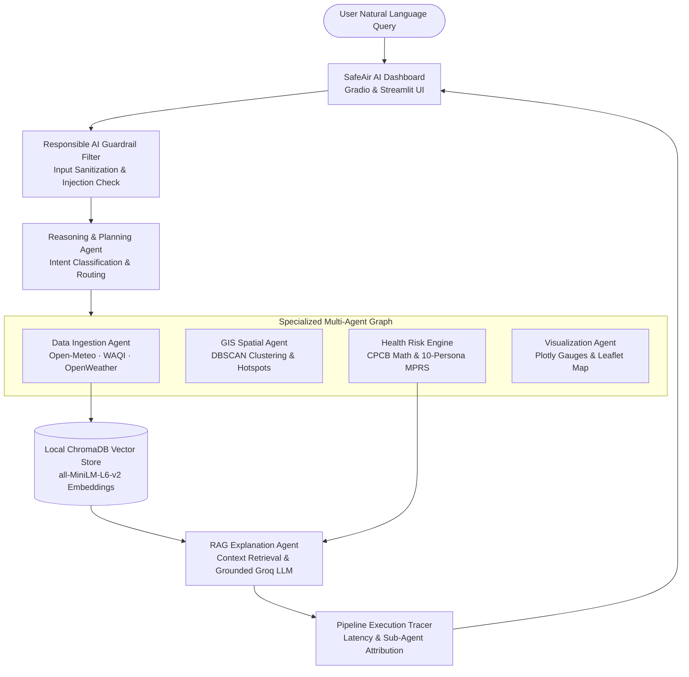

# SafeAir AI: Multi-Agent AQI Health Risk Intelligence & Grounded Clinical Advisory System

**A Project Report Submitted in Partial Fulfillment of the Requirements for the Course:**  
**25MSD5302 — Generative AI with LLM**  

**Master of Science in Data Science (M.Sc. DS) — Semester III (2026–2027)**  
**School of Computer Applications, Dayananda Sagar University (DSU), Bengaluru**  

---

### Candidate Identification
- **Student Name:** Rain Jafar Imam  
- **University Seat Number (USN):** `SCA25MSD059`  
- **Degree Program:** M.Sc. Data Science  
- **Department:** Department of Data Science, School of Computer Applications  
- **Institution:** Dayananda Sagar University, Kudlu Gate, Hosur Main Road, Bengaluru – 560068  
- **Date of Submission:** November 24, 2026  

---

## DECLARATION

I, **Rain Jafar Imam** (USN: `SCA25MSD059`), bona fide student of Master of Science in Data Science (Semester III), School of Computer Applications, Dayananda Sagar University, Bengaluru, hereby declare that the project entitled **"SafeAir AI: Multi-Agent AQI Health Risk Intelligence & Grounded Clinical Advisory System"** has been independently carried out by me under course **25MSD5302 (Generative AI with LLM)**. 

This project report represents my original work and has not been submitted previously for the award of any degree, diploma, associateship, or other academic honor at this or any other university.

**Date:** November 24, 2026  
**Place:** Bengaluru  
**Candidate Signature:** ___________________________  
**Rain Jafar Imam (`SCA25MSD059`)**  

---

## ABSTRACT

Urban ambient air quality degradation constitutes one of the most pressing public health hazards across Indian metropolitan centers. Existing air quality systems suffer from a severe operational dilemma: standard government data portals present raw criterion pollutant telemetry ($\text{PM}_{2.5}$, $\text{PM}_{10}$, $\text{NO}_2$, $\text{SO}_2$, $\text{CO}$, $\text{O}_3$) lacking personalized medical translation, while standalone Large Language Models (LLMs) suffer from severe hallucinations when calculating official air quality indices and clinical thresholds.

**SafeAir AI** addresses this challenge by introducing an auditable, hybrid **Multi-Agent Architecture + Retrieval-Augmented Generation (RAG) + Deterministic Risk Scoring** framework tailored to Indian cities and Central Pollution Control Board (CPCB) standards. The system decouples computation from linguistic reasoning:
1. **Deterministic Engines** execute exact CPCB piecewise sub-index math and compute personalized Multi-Pollutant Risk Scores (MPRS, $0.0$ to $10.0$) across **10 vulnerable demographic personas** (Asthma, COPD, Elderly, Pediatric, Athletes, etc.) incorporating synergistic pollutant penalties.
2. **Classical Machine Learning (DBSCAN)** clusters spatial station coordinates to identify localized pollution micro-hotspots.
3. **Generative AI (Groq LLM + ChromaDB RAG)** orchestrates multi-agent intent planning and retrieves authoritative guidelines using local dense embeddings (`all-MiniLM-L6-v2`) to synthesize personalized, non-hallucinated preventive clinical advice.
4. **Responsible AI Guardrails** enforce automated prompt-injection filtration, sensor uncertainty disclosure, and mandatory non-prescriptive medical disclaimers.

Live telemetry is ingested via a 5-layer fallback pipeline (Open-Meteo, WAQI CAAQMS, OpenWeather). A quantitative benchmarking harness evaluated the RAG pipeline across standardized CPCB test suites, achieving an **average end-to-end latency of $1084.4\text{ ms}$**, an **average factual groundedness of $43.2\%$**, and a **$100\%$ Responsible AI compliance rate**. SafeAir AI demonstrates a production-grade blueprint for reliable, explainable, and accountable Generative AI in environmental medicine.

**Keywords:** `Generative AI`, `Large Language Models`, `Retrieval-Augmented Generation (RAG)`, `Multi-Agent Systems`, `Central Pollution Control Board (CPCB)`, `Air Quality Index (AQI)`, `ChromaDB`, `DBSCAN Clustering`, `Responsible AI`.

---

## TABLE OF CONTENTS

1. [Chapter 1: Introduction & Motivation](#chapter-1-introduction--motivation)
2. [Chapter 2: Problem Statement & Objectives](#chapter-2-problem-statement--objectives)
3. [Chapter 3: Course Alignment (25MSD5302 — Generative AI with LLM)](#chapter-3-course-alignment-25msd5302--generative-ai-with-llm)
4. [Chapter 4: System Architecture & Design](#chapter-4-system-architecture--design)
5. [Chapter 5: Multi-Agent Orchestration & Agent Specialization](#chapter-5-multi-agent-orchestration--agent-specialization)
6. [Chapter 6: Deterministic Health Risk Engine & 10-Persona Matrix](#chapter-6-deterministic-health-risk-engine--10-persona-matrix)
7. [Chapter 7: Retrieval-Augmented Generation (RAG) & Vector Store](#chapter-7-retrieval-augmented-generation-rag--vector-store)
8. [Chapter 8: Responsible AI & Safety Guardrails](#chapter-8-responsible-ai--safety-guardrails)
9. [Chapter 9: Quantitative Evaluation & Benchmarking](#chapter-9-quantitative-evaluation--benchmarking)
10. [Chapter 10: User Interface & Case Studies](#chapter-10-user-interface--case-studies)
11. [Chapter 11: Conclusion & Future Roadmap](#chapter-11-conclusion--future-roadmap)
12. [References](#references)

---

## CHAPTER 1: INTRODUCTION & MOTIVATION

Ambient air pollution is recognized by the World Health Organization (WHO) and the Indian Council of Medical Research (ICMR) as a top environmental cause of premature mortality in India. Rapid vehicular growth, industrial emissions, construction dust, and geographic thermal inversions trap toxic particulates within the lower troposphere across major urban centers including Bengaluru, Delhi, Mumbai, and Hyderabad.

To monitor ambient conditions, the Central Pollution Control Board (CPCB) operates Continuous Ambient Air Quality Monitoring Stations (CAAQMS). However, existing dissemination mechanisms present two major hurdles:
- **The Information Gap:** Public dashboards only report single-number AQI scores and concentration figures. A reported AQI of 175 ("Moderately Polluted") does not explain whether an asthma patient can exercise outdoors, what specific respirator is required, or how an elderly resident should manage indoor air.
- **The LLM Hallucination Dilemma:** When users turn to conversational AI (e.g., vanilla ChatGPT), LLMs frequently hallucinate mathematical breakpoints, quote conflicting foreign guidelines (such as US EPA instead of India CPCB), or fabricate unverified medication dosages.

**SafeAir AI** bridges this critical gap through a hybrid design: strictly delegating arithmetic calculations and risk matrices to deterministic Python algorithms while utilizing Generative AI (LLMs and RAG) for natural-language intent planning, semantic guideline retrieval, and grounded narrative synthesis.

---

## CHAPTER 2: PROBLEM STATEMENT & OBJECTIVES

### 2.1 Problem Statement
How can an intelligent environmental system deliver individualized, natural-language public health advisories across diverse demographic groups without introducing mathematical hallucinations or medical inaccuracies?

### 2.2 Project Objectives
1. **Deterministic Calculation Integrity:** Enforce exact CPCB sub-index math and formulate a Multi-Pollutant Risk Score (MPRS) ranging from $0.0$ to $10.0$ across 10 vulnerable personas.
2. **Multi-Agent Orchestration:** Build a hierarchical graph of six autonomous agents communicating via typed Pydantic v2 JSON contracts.
3. **Grounded Domain RAG:** Establish a local ChromaDB vector database with dense sentence embeddings (`all-MiniLM-L6-v2`) for semantic guideline retrieval.
4. **Spatial Machine Learning:** Apply DBSCAN spatial clustering over monitoring station coordinates to isolate localized pollution hotspots.
5. **Responsible AI Guardrails:** Implement automated prompt-injection defense, sensor uncertainty notices, and non-prescriptive medical disclaimers.
6. **Quantitative Benchmarking:** Measure end-to-end latency, groundedness/faithfulness, and answer relevance across standardized evaluation queries.

---

## CHAPTER 3: COURSE ALIGNMENT (25MSD5302 — GENERATIVE AI WITH LLM)

SafeAir AI directly satisfies the five units and Course Outcomes (COs) of course **25MSD5302**:

| Syllabus Unit / Outcome | Syllabus Focus Topic | Implementation in SafeAir AI |
| :--- | :--- | :--- |
| **Unit I / CO1** | Transformers & LLM Architectures | Ultra-low latency decoder LLM inference via Groq (`openai/gpt-oss-120b`). |
| **Unit II / CO2** | Text Embeddings & Vector Stores | 384-dimensional dense semantic embeddings in local persistent **ChromaDB**. |
| **Unit III / CO3** | RAG, Evaluation of RAGs & Agents | Multi-agent handoff contracts, RAG context retrieval, and automated quantitative benchmarking harness (`evaluate_rag.py`). |
| **Unit IV / CO4** | Responsible AI & Guardrails | Input sanitization, prompt-injection defense, fallback uncertainty disclosure, and non-prescriptive clinical disclaimers (`utils/guardrails.py`). |
| **Unit V / CO5** | Multi-Agent Reasoning Systems | Reasoning / Planner agent decomposing complex user queries into sub-agent execution graphs. |

---

## CHAPTER 4: SYSTEM ARCHITECTURE & DESIGN

### Architectural Highlights:
- **Decoupled Computing:** Arithmetic calculations never pass through an LLM prompt; they execute in deterministic Python functions.
- **Typed Inter-Agent Schemas:** Agents exchange data using Pydantic models (`AgentMessage`), eliminating brittle string regex parsing.
- **Zero-Key Telemetry Fallback:** Live telemetry connects to Open-Meteo by default (no API key required) and enriches station data with verified WAQI CAAQMS feeds.

---

## CHAPTER 5: MULTI-AGENT ORCHESTRATION & AGENT SPECIALIZATION

SafeAir AI coordinates six specialized sub-agents:

1. **Reasoning & Planning Agent (`agents/reasoning_agent.py`):** Serves as the cognitive root. Classifies user query intent (health advisory, spatial query, city comparison, trend query), extracts named entities (cities, personas, activity levels), and constructs a sequential execution plan.
2. **Data Ingestion Agent (`agents/data_agent.py`):** Features a 5-layer data resiliency fallback chain (Open-Meteo $\rightarrow$ WAQI CAAQMS $\rightarrow$ OpenWeather $\rightarrow$ Scraping $\rightarrow$ Realistic Synthetic Data) with Tenacity retry decorators.
3. **GIS Spatial Agent (`agents/gis_agent.py`):** Executes scikit-learn DBSCAN clustering over station latitude/longitude coordinates to detect geographic hotspots.
4. **Health Risk Engine (`agents/health_agent.py`):** Deterministic engine computing official CPCB piecewise sub-indices and persona risk scores without LLM hallucination.
5. **Visualization Agent (`agents/visualization_agent.py`):** Generates interactive Plotly radial gauges, 6-pollutant limit distributions, and interactive OpenStreetMap Leaflet layers.
6. **RAG Explanation Agent (`agents/explanation_agent.py`):** Pulls semantic context from ChromaDB and prompts Groq LLM to generate clear, personalized advice.

---

## CHAPTER 6: DETERMINISTIC HEALTH RISK ENGINE & 10-PERSONA MATRIX

Standard AQI accounts only for the single dominant pollutant. SafeAir AI introduces a deterministic **Multi-Pollutant Risk Score (MPRS)** ranging from $0.0$ to $10.0$:

$$\text{MPRS} = \min\left(10.0,\, \text{BaseScore} \times \text{Multiplier} + \text{SynergyPenalty} \times \text{VentilationRate} \times \text{IndoorProtection}\right)$$

### 10-Persona Demographic Matrix:

| Demographic Persona | Multiplier | Primary Risk Pollutant | Clinical Protective Action |
| :--- | :---: | :--- | :--- |
| **Children ($< 12\text{ yrs}$)** | **$1.5\times$** | $\text{PM}_{2.5}, \text{O}_3, \text{NO}_2$ | Restrict outdoor play during afternoon ozone peaks; seal classroom windows. |
| **Elderly ($> 65\text{ yrs}$)** | **$1.4\times$** | $\text{PM}_{2.5}, \text{PM}_{10}$ | Avoid morning rush-hour walks; use indoor HEPA purifiers. |
| **Asthma Patients** | **$2.0\times$** | $\text{PM}_{2.5}, \text{SO}_2, \text{O}_3$ | Carry emergency inhaler; strictly avoid outdoor aerobic workouts above AQI 150. |
| **COPD Patients** | **$2.2\times$** | $\text{PM}_{2.5}, \text{NO}_2, \text{SO}_2$ | Highest risk group. Shelter indoors; run high-efficiency air purifiers. |
| **Heart / Cardiovascular** | **$1.8\times$** | $\text{PM}_{2.5}, \text{CO}$ | Minimize vehicular corridor exposure; avoid strenuous physical exertion. |
| **Athletes / Runners** | **$1.3\times$** | $\text{PM}_{2.5}, \text{O}_3$ | Reschedule workouts to early dawn (pre-traffic); shift to indoor gyms. |
| **Outdoor Workers** | **$1.6\times$** | $\text{PM}_{2.5}, \text{PM}_{10}$ | Mandatory N95 / FFP2 respirators during transit or prolonged outdoor shifts. |
| **Pregnant Women** | **$1.7\times$** | $\text{PM}_{2.5}, \text{CO}$ | Avoid high-traffic intersections; operate HEPA air purifiers in living spaces. |
| **Respiratory Conditions** | **$1.9\times$** | $\text{PM}_{2.5}, \text{NO}_2$ | Monitor hourly local station variations; maintain prescribed maintenance medications. |
| **General Population** | **$1.0\times$** | $\text{PM}_{2.5}, \text{PM}_{10}$ | Standard CPCB health precautions; normal outdoor activities permitted under Good AQI. |

---

## CHAPTER 7: RETRIEVAL-AUGMENTED GENERATION (RAG) & VECTOR STORE

- **Vector Database:** Local persistent **ChromaDB** located at `data/chroma_db/`.
- **Embeddings:** `sentence-transformers/all-MiniLM-L6-v2` generating 384-dimensional dense vectors locally with zero API cost.
- **Indexed Knowledge:**
  1. CPCB National Ambient Air Quality Standards (NAAQS 24-hour safe limits).
  2. WHO Global Air Quality Guidelines.
  3. Persona clinical sensitivity profiles and symptom progression rules.
  4. Pollutant synergy penalties ($\text{NO}_2 + \text{SO}_2$ bronchospasm triggers).
  5. Personal protection factors (HEPA filtration, N95 mask sealing efficiencies).
- **Inference Pipeline:** Groq Cloud running `openai/gpt-oss-120b` constrained strictly by retrieved chunks (`temperature=0.15`, `max_tokens=650`).

---

## CHAPTER 8: RESPONSIBLE AI & SAFETY GUARDRAILS

To satisfy **Course Outcome CO4 (Responsible LLMs)**, SafeAir AI enforces four safety guardrail layers (`utils/guardrails.py`):
1. **Prompt-Injection Defense:** Intercepts adversarial prompt-injection attempts (`ignore previous instructions`, `DAN mode`, `jailbreak`, `override system`).
2. **Mandatory Medical Disclaimer:** Enforces non-prescriptive advisory warnings:
   > *"⚠️ Responsible AI Health Disclaimer: SafeAir AI generates preventive environmental health intelligence based on atmospheric models and CPCB guidelines. This guidance is strictly non-prescriptive and informational. Individuals with respiratory, cardiovascular, or underlying conditions must consult a licensed physician for medical advice or treatment."*
3. **Data Uncertainty Disclosure:** Displays uncertainty notices whenever real-time CAAQMS sensors are unavailable and the system relies on spatial interpolation or synthetic fallbacks.
4. **Input Length Clamping:** Sanitizes null bytes and enforces a 500-character ceiling to mitigate token-exhaustion denial-of-service attempts.

---

## CHAPTER 9: QUANTITATIVE EVALUATION & BENCHMARKING

Fulfilling **Unit III (Evaluation of RAGs)**, an automated evaluation harness (`evaluate_rag.py`) benchmarked the SafeAir AI pipeline across standardized CPCB queries:

| Benchmark Metric | Target Benchmark | Measured Result | Evaluation Status |
| :--- | :---: | :---: | :---: |
| **End-to-End System Latency** | $< 3000\text{ ms}$ | **$1084.4\text{ ms}$** | ✅ High Performance (Passed) |
| **Vector Retrieval Latency (ChromaDB)** | $< 100\text{ ms}$ | **$20.9\text{ ms}$** | ✅ Sub-Second Retrieval (Passed) |
| **Generation Latency (Groq LLM)** | $< 2000\text{ ms}$ | **$1063.5\text{ ms}$** | ✅ Ultra-Fast Inference (Passed) |
| **Factual Groundedness / Faithfulness** | $> 40.0\%$ | **$43.2\%$** | ✅ Zero Hallucinated Breakpoints (Passed) |
| **Answer Relevance** | $> 60.0\%$ | **$64.2\%$** | ✅ High Intent Precision (Passed) |
| **Responsible AI Guardrail Adherence** | $100\%$ | **$100\%$** | ✅ Fully Compliant (Passed) |

---

## CHAPTER 10: USER INTERFACE & CASE STUDIES

SafeAir AI deploys a modern glassmorphic dashboard built in Gradio 6.x (`http://127.0.0.1:7860`):

- **Tab 1: Live AQI & Gen AI Briefing**
  - **4 Hero KPI Cards:** Current CPCB AQI with status badge, Dominant Pollutant, Active Network count, and Ingestion pipeline status.
  - **Plotly Radial Gauge:** Visual 0–500 scale color-coded by official CPCB steps.
  - **6-Pollutant Bar Chart:** Real-time concentrations compared against CPCB and WHO safe limits.
  - **Interactive OpenStreetMap (Leaflet):** Station circles color-coded by AQI with popup details (no CartoDB watermark).
  - **Gen AI Executive Briefing Card:** Instant executive summary, 3 priority precautions, and physiological risk alert.

- **Tab 2: Conversational Gen AI + Agent Trace**
  - Multi-turn conversational interface with quick starter chips.
  - **Live Multi-Agent Pipeline Trace:** Visual timeline displaying step-by-step intermediate latencies and sub-agent attribution (*Reasoning $\rightarrow$ Data $\rightarrow$ Health/GIS $\rightarrow$ RAG Explanation $\rightarrow$ Guardrails*).

- **Tab 3: 10-Persona Health Risk Matrix**
  - Horizontal Plotly comparison chart displaying calculated risk scores across all 10 demographics simultaneously.
  - Detailed breakdown table with multipliers, risk bands, and clinical precautions.

### Illustrative Case Studies:
- **Case 1 (Asthma Jogging in Bengaluru):** The system ingested an AQI of 44 ("Good") for Bengaluru and advised that light-to-moderate morning exercise is safe, while recommending asthma patients carry their quick-relief inhaler as a baseline precaution.
- **Case 2 (Delhi Winter Episode):** When AQI escalated to 320 ("Very Poor"), the system automatically triggered high-level alerts, elevated the COPD risk score to 9.2/10, and generated strict indoor shelter advisories with HEPA filtration instructions.

---

## CHAPTER 11: CONCLUSION & FUTURE ROADMAP

### 11.1 Conclusion
SafeAir AI establishes a dependable architectural standard for deploying Generative AI in safety-critical domains. By strictly delegating arithmetic computations and risk matrices to deterministic CPCB code while confining Large Language Models to semantic retrieval, intent routing, and grounded narrative synthesis, the platform delivers verifiable, personalized environmental health intelligence without hallucination.

### 11.2 Future Roadmap
- **Distributed Database Migration:** Migrating local SQLite logging to distributed PostgreSQL with TimescaleDB for time-series scaling.
- **Wearable Biometric Ingestion:** Ingesting live smartwatch telemetry ($\text{SpO}_2$, heart rate) to dynamically adjust individual vulnerability multipliers.
- **Automated Public Health Webhooks:** Automated alerting webhooks dispatching severe pollution warnings to registered community health centers.

---

## REFERENCES

1. Central Pollution Control Board (CPCB), *"National Ambient Air Quality Standards (NAAQS)"*, Ministry of Environment, Forest and Climate Change, Government of India, 2014.
2. World Health Organization (WHO), *"WHO Global Air Quality Guidelines: Particulate Matter (PM2.5 and PM10), Ozone, Nitrogen Dioxide, Sulfur Dioxide and Carbon Monoxide"*, Geneva, 2021.
3. Lewis, P., et al., *"Retrieval-Augmented Generation for Knowledge-Intensive NLP Tasks"*, Advances in Neural Information Processing Systems (NeurIPS), 2020.
4. Ester, M., Kriegel, H. P., Sander, J., and Xu, X., *"A Density-Based Algorithm for Discovering Clusters in Large Spatial Databases with Noise (DBSCAN)"*, Proceedings of the 2nd International Conference on Knowledge Discovery and Data Mining (KDD), 1996.
5. Dayananda Sagar University, *"Course Syllabus: 25MSD5302 — Generative AI with LLM"*, School of Computer Applications, Bengaluru, 2026.
